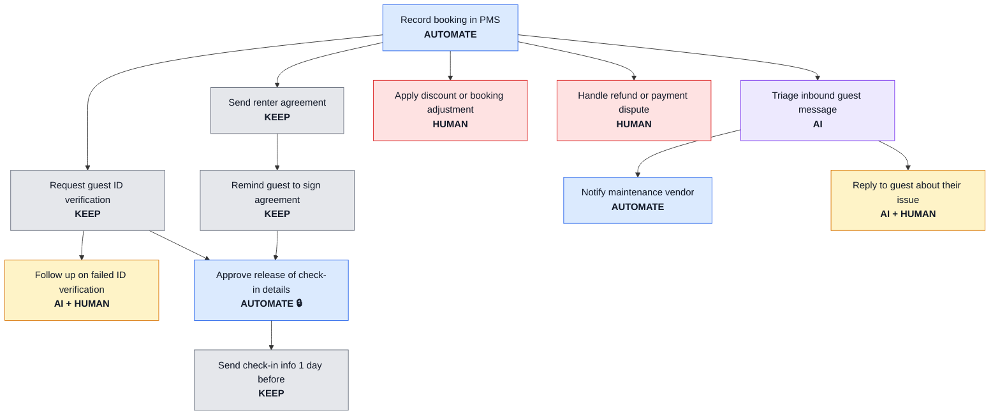

# ProcessLab

[](https://github.com/ynagonzalesss/processlab/actions/workflows/tests.yml)

**An AI that knows when *not* to use AI.**

ProcessLab takes a business process and decides, step by step, where AI belongs and where it doesn't. Each step lands in one of five lanes, and every placement comes with a reason you can audit.

| Lane | Meaning |
|---|---|
| ✅ KEEP | Already automated. Don't re-solve it. |
| ⚙️ AUTOMATE | Structured input + clear rule. Deterministic automation, no AI. |
| 🤖 AI | Messy input, low stakes, reversible. AI acts alone. |
| 🤖👤 AI + HUMAN | Messy input with real stakes. AI drafts, a human approves. |
| 👤 HUMAN | Irreversible or high-stakes judgment. |

## The core design choice

The LLM interprets. The rules engine decides.

A language model is good at reading messy input. It should not be the thing that decides whether a guest receives door codes. That decision is a rule, and rules don't need a language model. ProcessLab keeps lane assignment in plain, tested Python so every decision is repeatable and explainable.

## Status

- [x] **Phase 1:** Rules engine, schema, three example processes, tests
- [ ] Phase 2: LLM extraction (plain-language description → validated process JSON)
- [x] **Graph checks:** gate-input warnings, label sensitivity, Mermaid diagram of the redesign
- [ ] Phase 3: Redesign view + before/after comparison
- [ ] Phase 4: Simulation with sample cases + audit log
- [ ] Phase 5: Streamlit UI + public deploy

## Quick start

```bash
python3 -m venv .venv && source .venv/bin/activate
pip install -r requirements.txt
python -m processlab.cli examples/guest_onboarding.json
pytest
```

## Case study: vacation rental guest onboarding

Based on a real short-term rental operation I've supported for 3+ years.

```
STEP                                 LANE        RULE   OPP  GATE
------------------------------------------------------------------
Record booking in PMS                AUTOMATE    R2      62
Send renter agreement                KEEP        R1       0
Remind guest to sign agreement       KEEP        R1       0
Request guest ID verification        KEEP        R1       0
Follow up on failed ID verification  AI + HUMAN  R5      75
Approve release of check-in details  AUTOMATE    R2      62  🔒
Send check-in info 1 day before      KEEP        R1       0
Triage inbound guest message         AI          R4      88
Notify maintenance vendor            AUTOMATE    R2      50
Reply to guest about their issue     AI + HUMAN  R5      88
Apply discount or booking adjustmen  HUMAN       R6b     50
Handle refund or payment dispute     HUMAN       R3      75
```

8 manual steps before → 4 that still need a human after. One hard gate: check-in release is a compliance rule (agreement signed AND ID verified), so AI is excluded from it by design.

The same redesign as a diagram (`python -m processlab.cli examples/guest_onboarding.json --mermaid`):



## Tested on three different processes

The engine doesn't know anything about any of these industries. Same rules, three very different workflows:

| Process | Steps | Keep | Automate | AI | AI + Human | Human | Hard gate 🔒 |
|---|---|---|---|---|---|---|---|
| [Guest onboarding](examples/guest_onboarding.json) | 12 | 4 | 3 | 1 | 2 | 2 | Release check-in details |
| [Sales deal desk](examples/deal_desk.json) | 10 | 2 | 4 | 1 | 2 | 1 | Release order to billing |
| [AP invoice approval](examples/invoice_approval.json) | 12 | 2 | 4 | 2 | 2 | 2 | Release payment |

Across 34 steps, only 4 were a fit for AI acting alone, and another 6 for AI with a human approving. The rest were already automated, needed a clear rule, or needed a person.

The same pattern showed up in all three: the step that **releases something you can't take back** (door codes, revenue, money) is always a tested rule, never AI. The AI earns its keep earlier, reading the messy inputs (guest messages, rep emails, invoice PDFs) that feed those rules.

Run any of them:

```bash
python -m processlab.cli examples/deal_desk.json
python -m processlab.cli examples/invoice_approval.json
```

## The rules

Evaluated top to bottom; first match wins.

| Rule | Condition | Lane |
|---|---|---|
| R1 | Already automated | KEEP |
| R2 | Structured input + clear rule (🔒 hard gate if irreversible or high-stakes) | AUTOMATE |
| R3 | Irreversible, or high consequence in a financial / legal / safety / compliance domain | HUMAN |
| R4 | Unstructured + low consequence + reversible | AI |
| R5 | Unstructured, anything else | AI + HUMAN |
| R6a | Structured, unclear rule, low consequence | AI + HUMAN |
| R6b | Structured, unclear rule, higher consequence | HUMAN |

Thresholds and weights live in [`processlab/config/thresholds.yaml`](processlab/config/thresholds.yaml).

## Guardrails are tested, not promised

`tests/test_engine.py` runs every combination of step attributes (14,580 cases) and checks that:

- AI never acts alone on anything consequential or irreversible
- High-stakes decisions never reach an AI lane
- Irreversible automation is always a hard gate
- Anything with a clear rule on structured data never uses AI

If a future rule change breaks one of these, the build fails.

## Checks beyond the lane

The engine scores each step on its own. Two checks then look at the whole process:

- **Gate inputs.** A hard gate excludes AI from the decision, but not from the data feeding it. If a gate depends, directly or through other steps, on a step where AI acts alone, the report warns and asks for a rule or human check in between.
- **Label sensitivity.** Step attributes are assigned by judgment. For each step, the report lists every one-notch label change (for example consequence low → medium) that would move it to a different lane, so a reviewer knows which labels to question first.

Both appear in the CLI output and in `--json` (`warnings`, `fragile_on`).

## Project structure

```
processlab/
├── processlab/
│   ├── schema.py          # Pydantic contracts (strict: unknown fields rejected)
│   ├── engine.py          # Deterministic lane assignment, no LLM
│   ├── analysis.py        # Gate-input warnings, label sensitivity
│   ├── diagram.py         # Mermaid flowchart of the redesign
│   ├── cli.py             # Run the engine on a process file
│   └── config/thresholds.yaml
├── examples/               # guest onboarding, deal desk, invoice approval
├── tests/
└── docs/design-decisions.md
```

See [`docs/design-decisions.md`](docs/design-decisions.md) for the reasoning behind the rules.
